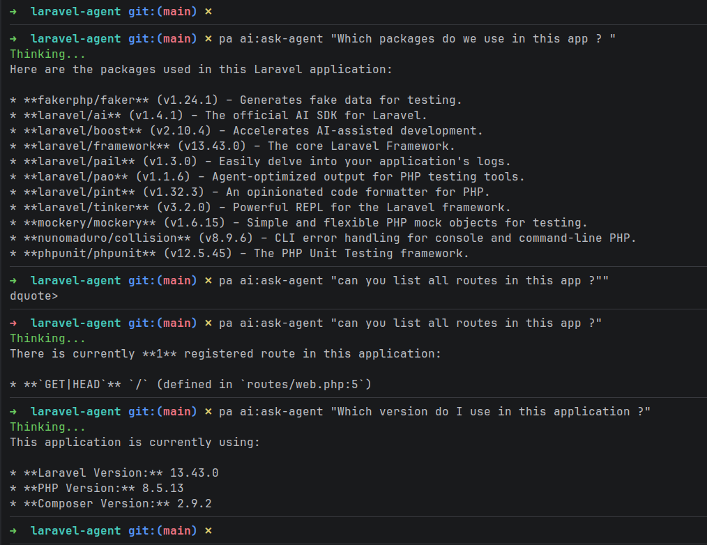

# Laravel AI Agent

A Laravel 13 application demonstrating an AI-powered CLI assistant built with the official [Laravel AI SDK](https://laravel.com/docs/ai) (`laravel/ai`). You can ask natural-language questions about the application from the terminal, and the agent inspects the project in real time using custom tools before answering.

## How It Works

- **Artisan Command** (`app/Console/Commands/TestAiAgent.php`): Exposes `ai:ask-agent {question}`, which sends your prompt to `AskLaravelAgent` and prints the response.
- **AI Agent** (`app/Ai/Agents/AskLaravelAgent.php`): Implements `Agent`, `Conversational`, and `HasTools`, instructing the model to answer questions strictly from tool output without inventing details.
- **Inspection Tool** (`app/Ai/Tools/InspectLaravelApp.php`): Provides the agent with three inspection actions:
  - `about` — runs `php artisan about` for framework, PHP, Composer, and environment details.
  - `routes` — runs `php artisan route:list --except-vendor` to list registered application routes.
  - `packages` — runs `composer show --direct` to list direct Composer dependencies.

## Requirements & Setup

- PHP `^8.5`
- Composer
- Node.js & npm (optional, for frontend assets)
- An AI provider API key configured in `.env` (see `config/ai.php`)

```bash
composer run setup
```

Then add your AI provider credentials to `.env` before running the agent.

## Usage Examples

Ask the agent about installed packages, routes, or framework/runtime versions:

```bash
php artisan ai:ask-agent "Which packages do we use in this app ? "
php artisan ai:ask-agent "can you list all routes in this app ?"
php artisan ai:ask-agent "Which version do I use in this application ?"
```

### Example Output



## License

This project is open-sourced software licensed under the [MIT license](https://opensource.org/licenses/MIT).
